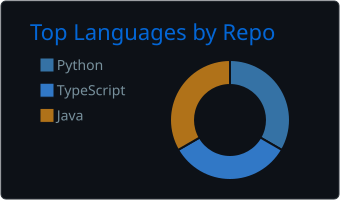
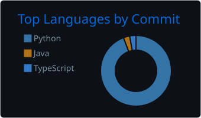

# Hi, I'm Sinan 👋

Media Informatics student at BHT Berlin, 5th semester.
I like building web apps end to end: from the interface in the browser to the API and the database behind it, and automating the boring parts of real workflows.

📍 Berlin · 🔎 Looking for a **working student position** (**15–20 h/week**) in full-stack / frontend / backend development, software engineering or AI & automation

## 🛠️ Tech Stack

- **Languages:** TypeScript, Java, Python, HTML/CSS, SQL
- **Frontend:** HTML, CSS, TypeScript (compiled with `tsc`), responsive layouts
- **Backend:** Node.js, REST APIs, Django (basics)
- **Databases:** PostgreSQL, SQLite, MongoDB / Mongoose (basics)
- **Tools & DevOps:** Git & GitHub, Docker, Docker Compose, VS Code
- **Desktop:** JavaFX

  
  

## 📌 Projects

- **[Fiber Optic Survey Web App](https://github.com/sinan-nis/fiber-survey-app):** freelance project for a construction company. Web app for recording fiber optic installation measurements digitally instead of on paper, generating PDFs, Excel reports and invoices. TypeScript, Node.js, SQLite, Docker
- **Uhmless:** web app for practicing impromptu speaking. Random topic, 3 minutes of talking, then an analysis of filler words, speaking pace and clarity. TypeScript, Node.js, MediaRecorder API, speech-to-text, LLM-based analysis *(work in progress)*
- **Appointment Calendar App:** desktop app for managing appointments with a graphical interface in Java/JavaFX
- **[Ray Tracer](https://github.com/sinan-nis/java-ray-tracer):** recursive ray tracer from scratch in Java: Phong shading, shadows, glass & metal materials, anti-aliasing
- **[LeetCode](https://github.com/sinan-nis/LeetCode):** algorithms and data structures in Python and TypeScript *(ongoing)*

## 🎓 Education

**B.Sc. Media Informatics**, Berliner Hochschule für Technik (BHT), since 10/2024 · expected graduation 2027
Coursework: web engineering (TypeScript, Node.js, MongoDB), web programming with Python (Django), software engineering, databases, computer graphics

## 🌱 Currently

- Building Uhmless 
- Deepening TypeScript and backend development 
- Learning Django, Python
- Solving LeetCode problems in Python and TypeScript

## 🌍 Languages

German (native) · English (fluent) · Turkish (basic) · French (basic)

## 📫 Contact

